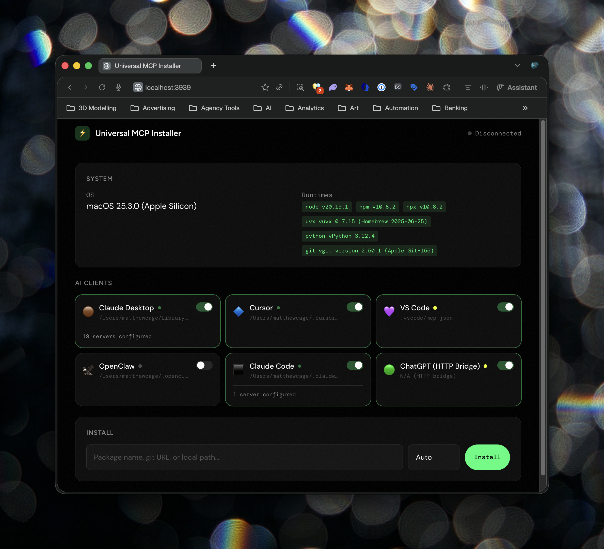

<p align="center">

```
             _   _ _   _ _____     _______ ____  ____    _    _     
            | | | | \ | |_ _\ \   / / ____|  _ \/ ___|  / \  | |    
            | | | |  \| || | \ \ / /|  _| | |_) \___ \ / _ \ | |    
            | |_| | |\  || |  \ V / | |___|  _ < ___) / ___ \| |___ 
             \___/|_| \_|___|  \_/  |_____|_| \_\____/_/   \_\_____|
                                                          
      __  __  ____ ____    ___ _   _ ____ _____  _    _     _     _____ ____  
     |  \/  |/ ___|  _ \  |_ _| \ | / ___|_   _|/ \  | |   | |   | ____|  _ \ 
     | |\/| | |   | |_) |  | ||  \| \___ \ | | / _ \ | |   | |   |  _| | |_) |
     | |  | | |___|  __/   | || |\  |___) || |/ ___ \| |___| |___| |___|  _ < 
     |_|  |_|\____|_|     |___|_| \_|____/ |_/_/   \_\_____|_____|_____|_| \_\
```

</p>

<div align="center">

  <p>Install and configure MCP servers across all major AI clients with one command.</p>

  [](https://opensource.org/licenses/MIT)
  [](https://www.npmjs.com/package/universal-mcp-installer)
  [](https://github.com/anthropic-labs/model-context-protocol)
  [](https://www.npmjs.com/package/universal-mcp-installer)

  <a href="https://www.linkedin.com/in/digitalmarketingstrategyexpert/">
    
  </a>

</div>

> **🚀 NEW: Universal MCP Installer v1.0.0** — Complete rewrite of `cursor-mcp-installer`. Now supports **6 AI clients** (Claude Desktop, Cursor, VS Code, OpenClaw, Claude Code, ChatGPT), **cross-platform** (macOS, Windows, Linux), real **MCP handshake validation**, and a **branded web dashboard**. Upgraded to MCP SDK 1.29.0.

> **🖥️ Web Dashboard Available!** Launch with `npx universal-mcp-installer --ui` to manage everything from a visual interface. See [Using the Dashboard](#using-the-dashboard) below.

<p align="center">
  
</p>

## Quick Start Guide

### Step 1: Install an MCP Server (One Command)

```bash
npx universal-mcp-installer install @modelcontextprotocol/server-memory
```

That's it. The installer detects which AI clients you have installed and writes the correct config for each one.

### Step 2: Or Add as an MCP Tool (Let Your AI Install Other MCP Servers)

Add this to your AI client's MCP configuration:

#### Cursor (`~/.cursor/mcp.json`)

```json
{
  "mcpServers": {
    "MCP Installer": {
      "command": "npx",
      "type": "stdio",
      "args": ["-y", "universal-mcp-installer"]
    }
  }
}
```

#### Claude Desktop (`claude_desktop_config.json`)

```json
{
  "mcpServers": {
    "MCP Installer": {
      "command": "npx",
      "args": ["-y", "universal-mcp-installer"]
    }
  }
}
```

#### VS Code (`.vscode/mcp.json`)

```json
{
  "servers": {
    "mcpInstaller": {
      "type": "stdio",
      "command": "npx",
      "args": ["-y", "universal-mcp-installer"]
    }
  }
}
```

### Step 3: Restart Your AI Client

Close and reopen your AI client to apply the configuration changes.

### Step 4: Ask Your AI to Install Servers

```
Install the filesystem MCP server
```

or

```
Install the web search MCP server
```

The installer exposes three tools your AI can call:

| Tool | Description |
|------|-------------|
| `detect_system` | Returns OS, architecture, available runtimes, and detected AI clients |
| `install_mcp_server` | Installs a server by package name, git URL, or local path to selected clients |
| `validate_mcp_server` | Validates a server via MCP handshake and returns the result |

## Using the Dashboard

Launch the visual interface:

```bash
npx universal-mcp-installer --ui
```

This opens web interface in your browser at `http://localhost:3939`:

<p align="center">
  
</p>

**1. System Panel** — The top section automatically detects your OS and all available runtimes (Node, npm, uvx, Python, git) so you can see at a glance what's available on your machine.

**2. AI Clients** — Each detected client gets a card showing its name, config file path, and how many MCP servers are already configured. Use the toggle switch on each card to include or exclude it from the next installation. Uninstalled clients appear dimmed.

**3. Install** — Type a package name (npm package, git URL, or local path), pick a method from the dropdown (`Auto` / `npm` / `uvx` / `git` / `local`), and hit the green **Install** button. The installer resolves the package, writes config to every toggled client, and validates via MCP handshake.

**4. Progress & Results** — A real-time timeline shows each step (resolving, writing config, validating) with live status updates via WebSocket. Once complete, a health report grid shows pass/fail per client with tool counts, latency, and recovery hints for any failures.

## Supported Clients

| Client | Config Key | Platforms |
|--------|-----------|-----------|
| **Claude Desktop** | `mcpServers` | macOS, Windows, Linux |
| **Cursor** | `mcpServers` | macOS, Windows, Linux |
| **VS Code (Copilot)** | `servers` | All (workspace-level) |
| **OpenClaw / NemoClaw** | `mcp.servers` | macOS, Linux |
| **Claude Code** | `mcpServers` | macOS, Windows, Linux |
| **ChatGPT Desktop** | HTTP Bridge | All (via local HTTP proxy) |

### Where Are the Config Files?

| Client | macOS | Windows | Linux |
|--------|-------|---------|-------|
| **Claude Desktop** | `~/Library/Application Support/Claude/claude_desktop_config.json` | `%APPDATA%\Claude\claude_desktop_config.json` | `~/.config/Claude/claude_desktop_config.json` |
| **Cursor** | `~/.cursor/mcp.json` | `%USERPROFILE%\.cursor\mcp.json` | `~/.cursor/mcp.json` |
| **VS Code** | `.vscode/mcp.json` (workspace) | `.vscode/mcp.json` (workspace) | `.vscode/mcp.json` (workspace) |
| **OpenClaw** | `~/.openclaw/openclaw.json` | - | `~/.openclaw/openclaw.json` |
| **Claude Code** | `.mcp.json` (project root) | `.mcp.json` (project root) | `.mcp.json` (project root) |

## Features

- **Auto-detection** of installed AI clients and their config paths
- **Runtime detection** for Node.js, npm, npx, uvx, Python, and git
- **Multiple install methods**: npm, uvx, git clone, local path
- **Config safety**: backs up existing configs, atomic writes, never clobbers unrelated keys
- **Real MCP handshake validation**: spawns the server, sends `initialize`/`initialized`, calls `tools/list`
- **Health reports**: structured pass/fail per client with tool count, latency, and recovery hints
- **Known-issue recovery**: 13+ error codes with actionable fix suggestions
- **Cross-platform**: Windows `cmd /c npx` wrapping, Linux XDG paths, macOS launchd support
- **Service templates**: generate launchd (macOS), systemd (Linux), or Task Scheduler (Windows) configs
- **Web dashboard**: branded React UI with real-time WebSocket progress updates

## Prerequisites

- [Node.js](https://nodejs.org/) v18 or later
- At least one supported AI client installed

Optional:
- [uv/uvx](https://docs.astral.sh/uv/) for Python MCP servers
- [git](https://git-scm.com/) for installing from repositories

## CLI Reference

```bash
# Detect your system, runtimes, and installed AI clients
npx universal-mcp-installer detect

# Install an MCP server to all detected clients
npx universal-mcp-installer install @modelcontextprotocol/server-memory

# Install to specific clients only
npx universal-mcp-installer install my-server --clients cursor,claude-desktop

# Install with environment variables
npx universal-mcp-installer install my-server --env API_KEY=sk-123

# Install from a git repository
npx universal-mcp-installer install https://github.com/user/mcp-server.git

# Install from a local directory
npx universal-mcp-installer install ./my-local-server --method local

# Validate an MCP server by running the handshake
npx universal-mcp-installer validate npx -y @modelcontextprotocol/server-memory

# Launch the web dashboard
npx universal-mcp-installer --ui
```

### CLI Options

| Option | Description |
|--------|-------------|
| `--clients <ids>` | Comma-separated client IDs: `cursor`, `claude-desktop`, `vscode`, `openclaw`, `claude-code`, `chatgpt` |
| `--method <method>` | Install method: `auto`, `npm`, `uvx`, `git`, `local` |
| `--env KEY=value` | Environment variable (repeatable) |
| `--args <arg>` | Server argument (repeatable) |
| `--no-validate` | Skip MCP handshake validation after install |
| `--port <number>` | Dashboard port (default: 3939) |

## API Endpoints (Dashboard Mode)

When running with `--ui`, a local API is available:

| Endpoint | Method | Description |
|----------|--------|-------------|
| `/api/system` | GET | System info, runtimes, detected clients |
| `/api/clients` | GET | Client detection details |
| `/api/install` | POST | Trigger installation |
| `/api/validate` | POST | Trigger MCP handshake validation |
| `/ws` | WebSocket | Real-time progress events |

## Development

```bash
# Clone and install
git clone https://github.com/matthewdcage/cursor-mcp-installer.git
cd cursor-mcp-installer
npm install

# Build the server
npm run build

# Build the dashboard
cd dashboard && npm install && npm run build && cd ..

# Run tests (real MCP handshake, no mocks)
npm test

# Watch mode
npm run dev
```

### Project Structure

```
src/
  index.ts               MCP server entry (stdio)
  cli.ts                 CLI entry (npx)
  detect/                OS, runtime, client detection
  clients/               Config writers per AI client
  install/               Package resolution (npm, uvx, git, local)
  validate/              MCP handshake + health reports
  api/                   HTTP/WebSocket API for dashboard
  utils/                 Config I/O, logging, errors, platform utils
dashboard/               React + Vite + Tailwind web UI
tests/                   Unit, integration, E2E tests
docs/                    Localized official MCP docs
```

## Changelog

### v1.0.0 (Universal Rewrite)

- Complete rewrite from `cursor-mcp-installer` (v0.1.3) to `universal-mcp-installer`
- Upgraded MCP SDK from `^1.0.1` to `^1.29.0` (28 minor versions)
- Added support for 6 AI clients (was Cursor-only)
- Added real MCP handshake validation (was none)
- Added cross-platform support with platform-specific config paths
- Added CLI with `detect`, `install`, `validate` commands
- Added web dashboard with React + Tailwind + WebSocket
- Added 50+ real tests (was `echo "No tests specified"`)
- Added known-issue error recovery database
- Added service template generation (launchd, systemd, Task Scheduler)
- Replaced `rimraf`/`spawn-rx` with Node built-ins
- Fixed: `require.resolve` in ESM context
- Fixed: `console.error`/`console.warn` corrupting stdio JSON-RPC stream
- Full TypeScript source (was compiled JS-only artifact)

## License

[MIT](LICENSE)
